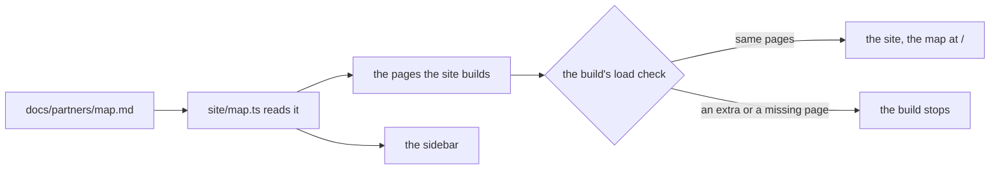

# The docs site publishes exactly the map's pages, recap, 2026-11-20

You said of the map: "the map is perfect starting point, and on your question, yes publish exactly the map's pages". The map is now the site's first page and the one list its build reads: a page not on it is not published, and a map line with no page stops the build.

## What it does now

- The map sits at `docs/partners/map.md` and is the site's root. Each line's name links its page; the three "not yet written" lines stay, with no page and no sidebar entry.
- The sidebar is the map, then its branches in order, each page under its map name.
- A link to a page that left the site opens it on GitHub.

## What was proved

- Ten unit tests: nine, one for each case of the plan, and one for the empty map that the review added. The nine ran red before the refusals existed, then green. Each of the nine was then seen to bite by breaking its one branch (the first, second and fourth through the real builds below).
- Real builds were each seen red and put back: three of the map's refusals (an extra page given to the docs plugin, named as not on the map; a map line linking a missing file, named by its line; the front matter removed, the map not at the root), Docusaurus's own broken-link check (the link rewrite given the old globs), and a second docs plugin, whose page was named as not on the map. A map with no page under its heading is refused and held by a unit test.

## Looks

- **Seen, 2026-11-20:** you looked at the built site's shape and said "the skeleton and directory structure is good". Next you asked that each page's own words be checked for whether a partner can read them.

## What came from where

Commits `4d9a3006`, `a48cfb37` and `47c718e6`, from `pre-merge` at `489b1215`. The decision is the 2026-11-20 line of `docs/decisions.md`. No open item filed.

Step 6, the products page for partners, is in [its own recap](2026-11-20-products-partner.md).
