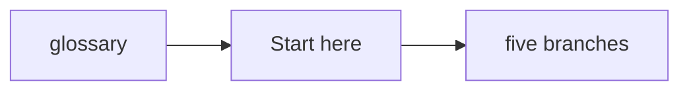

# The other pages remade, recap, 2026-11-20

This continues [the products page's recap](2026-11-20-products-partner.md). You said yes to the sort, to Start here and to the five other drafts. Each partner page now says who it is for and what you can do after it. The machine's pages stay, with a pointer where a partner page took their steps.

## What a partner finds

- **Start here:** the front page and questions rewritten; a new glossary, one heading a word.
- **Product owner:** a rewritten page and "Can we take a real client yet?", three facts marked unconfirmed.
- **Sales partner:** a rewritten page: a first action, what not to promise.
- **Operator:** a rewritten page and a console page for tasks without typing; the runbook has a new first screen and "Use this when" lines.
- **New developer:** a rewritten page and setup page; a first screen on the quick start and architecture.
- **Code and QA rules:** a new first screen, the history at the end, long sentences split; the tester's page rewritten.

## What the machine decided

- "Gate" and "whole check" are two glossary words.
- A glossary link with no heading is dropped, not given a word.
- The code and QA rules keep "the human", glossed in their opening as the project's owner.
- The runbook's and code rules' prose moves wait in item 635: the operator works only in the console today, and those pages' readers code.

## What was proved

Each step's site build was made to fail once on a broken glossary link or a one-sided pair, then put back. The site's gate, the citation test and the drafts' own checks passed after.

## What is left

- Item 632: the map's "ask the human", the QA branch's name, the front page's role list, the runbook.
- Item 635.
- The push that publishes the site is yours. No look is open.
