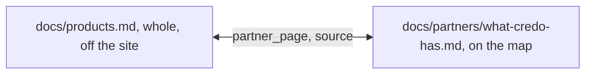

# The products page for partners, recap, 2026-11-20

This continues [the docs map's recap](2026-11-20-docs-map.md). You decided "one reader a page": a page that fails for partners is not rewritten in place. It stays whole as the machine's page, leaves the map, and a partner page written from it takes its place. You said yes to the drawn page with two changes: "call me 'us'" and "we can remove What comes next now".

## What partners get now

- The map's products line opens "What credo has today": what works, what is not built, and how to check a piece yourself, in plain words. It speaks as "us" and has no "What comes next".
- The operator guide, the product owner's page and the sales partner's page open its check section there.

## What stays with the machine

- `docs/products.md` is whole, plus one front-matter line naming its partner page. The steps a partner follows moved, so each fact has one home; a one-line pointer stays. Who holds which demo copy, the receipt and the gallery's card stay.
- The site no longer publishes it; a link to it opens on GitHub.

## The pair, and its refusal

The two pages name each other in front matter. The build stops when a published page names a source that is no file or does not name it back, or a machine's page names a partner page that is not on the map or does not name it back.

## What was proved

- Each of four refusal cases ran red on its own assertion before the refusal existed, then green.
- One real build was red by name with the machine's page's back-reference removed, then put back and green. The built site holds the new page and no products page.

## What came from where

The decision is the 2026-11-20 line of `docs/decisions.md`; `site/CLAUDE.md` holds the rule. Item 632 gains a line: the operator guide and the runbook still wait. The docs site's products row changes nothing.
