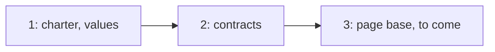

# The design guideline's skeleton, recap, 2026-11-21

You asked to decide the design once, so a screen's coder makes as few look-and-feel choices as possible. This recap holds landings 1 and 2 of 3; landing 3 (steps 10 to 12) is to come.

## What landing 1 gives you

- **Start here**: your goal, the two readers, the rules, each saying what holds it and whether the app follows it. A gap is asked, then made a rule; a screen's coder picks parts, never a style.
- **Values**: what each colour, text style, gap, width, icon size, corner, shadow and format is for. Four meanings (danger, success, warning, info) are the one place a colour name is written.
- It lives in `ui/src/design-system/guideline.ts`, where `ui/CLAUDE.md`'s look rules moved.

## What landing 2 gives you

- Each part has a **contract**: what a screen gives it (content or meaning, never a style), what it decides from the theme, the rule it serves.
- **FormMessage**, **PageState** and **ActionButton** (main, other, quiet, danger) are parts to come, drawn from Mantine. **StatusBadge** is built over every order, request and person status; no screen uses it yet.
- A new rule: a page has one main action, red only at a delete's last step, which a page of its own confirms (item 306). The 109 buttons are counted and mapped to meanings; item 655 moves them.

## What was proved

Steps 1 to 8, each case seen red first; items 629, 649, 654 fixed. No screen's look moved: the pinned styles file is unchanged.
<!-- FILL: the whole check on pre-merge, for the piece's last landing -->
<!-- FILL: the review before main, for the piece's last landing -->
Landings 2 and 3 move `main` on `ui`'s and `visual`'s own checks and the citation test, with no whole check and no review (QA's rule of 11-21).

## What is left

- Point 1: yes, 11-21.
- <!-- FILL: your answer at point 2; strike this line when it comes -->Point 2: open the gallery (its card is in the products page). Do `ActionButton` and `StatusBadge` read as the one way, nothing left for a screen to choose? A no names the part.
- Rules and Pages stay empty until landing 3.
