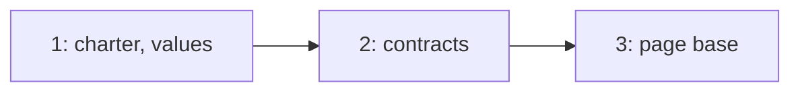

# The design guideline's skeleton, recap, 2026-11-21

You asked to decide the design once, so a screen's coder makes few look-and-feel choices. This recap holds the three landings.

## What each landing gives you

- **Landing 1, Start here and Values**: your goal, the two readers, the rules, and what each value is for. Four meanings (danger, success, warning, info) are the one place a colour name is written.
- **Landing 2, contracts**: each part states what a screen gives it (content or meaning, never a style), what it decides, the rule it serves. **FormMessage**, **PageState** and **ActionButton** are parts to come; **StatusBadge** is built, no screen uses it yet. A page has one main action (item 306); the 109 buttons are mapped to meanings (item 655).
- **Landing 3, Pages**: the frame, then one page drawn from parts only, slot by slot: back link, title, main action, status, blocks, fields, table, message. Every other part has its contract, and a duplicate's winner is named on the other's entry. A table's least width is a `WIDTHS` key (item 653). The charter gains two rules: a part's look is the design-system coder's, and feedback reaches that coder in its giver's words; a kind of page is written at its first page.

## What was proved

Each case seen red first; items 629, 649, 654 fixed. No screen's look moved: the pinned styles file is unchanged.
The whole check: landing 1's passed on its final commit before `main` moved; landings 2 and 3 are checked by `ui`'s and `visual`'s own checks and the citation test, by QA's rule of 11-21.
The review: landing 1's asked for text fixes, made and reread before `main` moved; landings 2 and 3 get none, by the same rule.

## What is left

- Point 1: yes, 11-21. Point 2: yes, 11-21 ("1 yes"); a part's look details are the design-system coder's.
- Point 3, open: in the gallery's Pages group, is this the base a new page is built from, with no style chosen in it? A yes closes landing 3; a no names the slot or part, and step 10 or 11 reopens.
- The screens move to the guideline in the next milestone (item 651).
