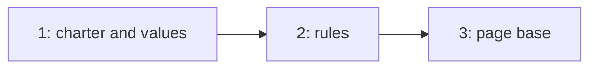

# The design guideline's skeleton, recap, 2026-11-21

You asked to decide the design once, so a screen's coder makes as few look-and-feel choices as possible. This recap holds landing 1 of 3, the floor; landings 2 and 3 add below.

## What landing 1 gives you

- **Start here** is the gallery's first page, the bare address: your goal, what credo is, the two readers, where each looks, seven rules, each saying what holds it and whether the app follows it. A gap is asked, then made a rule. A screen's coder picks parts, never a style; a design-system coder owns each look.
- **Values** says what each colour role, text style, gap, width, icon size, corner, shadow and format is for, and draws each. Four meanings (danger, success, warning, info) are the one place a colour name is written.
- **The 15 entries** (11 parts) say when to use, when not, and what instead, but BackLink, StatusBadge and Mantine's.
- It all lives in `ui/src/design-system/guideline.ts`, which a coder reads as text and the gallery draws.

## What the machine decided

- `ui/CLAUDE.md`'s look rules moved into the guideline.
- A rule the app does not follow yet (colour names, sizes and widths as numbers, 5 `new Intl.` sites) says so, with its item.
- Items 629 and 649 are fixed; item 647's theme half is fixed, its 550 weight waits for the dialog's move.

## What was proved

Steps 1 to 5: `10e505e6`, `babd456f`, `da4df0a4`, `f673aa0c`, `9dfe105c`. Each case was seen red first. No screen's look moved: the pinned styles file is unchanged. Step 5 touched the frame's stylesheet and the sign-in title, to name the same sizes and weights once.
<!-- FILL: the whole check on pre-merge, once it has run -->
<!-- FILL: the review before main, once it has run -->

## What is left

- Your look at point 1, asked again after landings 2 and 3 are reshaped: open the gallery (its card is in the products page). Could a screen's coder pick each part without asking? A no names the line.
<!-- FILL: your answer at point 1; strike "Your look at point 1" when it comes -->
- Rules and Pages stay empty until landings 2 and 3. Moving the screens is the next milestone.
