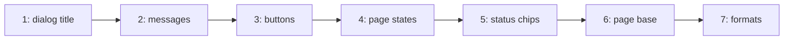

# The screens moved onto the parts, recap, 2026-11-21

You asked for the app's screens to move onto the parts, one pattern at a time, so a screen's coder passes content and meaning, never a style. The piece has seven landings; this recap is begun at the first and grows with each.

## What each landing gives you

- **Landing 1, the dialog's title at 600**: the "sign-in ended" dialog of the passkeys screen now draws its title at the guideline's emphasis weight, 600, where it drew 550, a weight the guideline does not name. That is the only screen that moves, in English and Vietnamese at the three widths, six pictures. Item 647's last half is fixed.
- **Landings 2 to 7**: <!-- FILL: each landing's change for a user, when it lands -->

## What was proved

- **Landing 1**: the value was seen red on the old 550, then green, and the pinned styles file changed for that one screen alone. <!-- FILL: landing 1's check run, in words -->
- Your first picture run of landing 1 wrote the six new pictures, committed alone. <!-- FILL: your second picture run of landing 1, in words -->
- **Landings 2 to 7**: <!-- FILL: each landing's checks, in words -->

## What is left

- <!-- FILL: your five points, one yes or no each: messages, buttons, page states, status chips, the page base -->
- The doors' looks, dark mode and a confirm as a page stay out (items 651, 307, 306).
