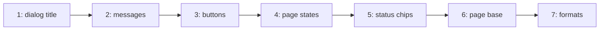

# The screens moved onto the parts, recap, 2026-11-21

You asked for the app's screens to move onto the parts, one pattern at a time, so a screen's coder passes content and meaning, never a style. The piece has seven landings; this recap grows with each.

## What each landing gives you

- **Landing 1, the dialog's title at 600**: the "sign-in ended" dialog of the passkeys screen draws its title at the guideline's emphasis weight, 600, not 550. Only that screen moves, six pictures. Item 647's last half is fixed.
- **Landing 2, the messages**: every message under a form or an act is drawn by one part, in its kind's colour and spoken role, spanning its column (the three page states and the logo refusal stay). Seven screens moved, three lines from red or yellow to orange. You said yes to the seven messages.
- **Landing 3, the buttons**: every button is drawn by its meaning, one size but the sign-in doors; a page's next step is its one filled button, red only at a delete's last step, and the rest plain or quiet. The person page, lock confirm open, and a draft order draw two main actions: we ask you whether that is right.
- **Landings 4 to 7**: <!-- FILL: each landing's change for a user, when it lands -->

## What was proved

- **Landing 1**: the value was seen red on the old 550, then green. <!-- FILL: landing 1's check run, in words -->
- **Landing 2**: your first picture run, over all twelve walks, wrote the pictures, committed alone; your second, over the four walks that changed, read green. The whole check and the review are still to come.
- **Landing 3**: your write run over all twelve walks wrote the pictures, committed alone. Its check run, the landing and the review are still to come.
- **Landings 4 to 7**: <!-- FILL: each landing's checks, in words -->

## What is left

- <!-- FILL: your five points, one yes or no each: messages, buttons, page states, status chips, the page base -->
- The doors' looks, dark mode and a confirm as a page stay out (items 651, 307, 306).
