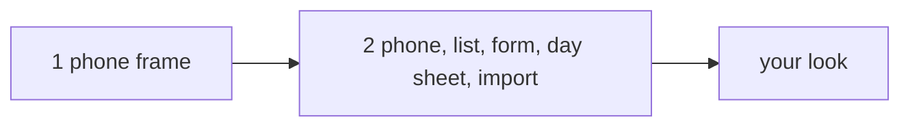

# The gallery's missing pages, recap, 2026-11-22

You asked for the gallery to show every kind of page the app's screens are, the phone's drawn at its width, so a coder builds a new page from a kind, not from a copy.

## What landing 1 gives you

- The gallery has a kind "Kinds of page"; each entry draws its states from parts only and says, under "A new page of this kind must have", what a new page of its kind needs.
- A phone plate draws a page 390 px wide in a frame whose breakpoints are the phone's; the mock's frame draws as before.
- Five pages: the phone page (six states), the list page (six, the last a card a row at the phone's width), the form page (four), the day sheet (three) and the import page (choose, the preview, done). The gallery holds 41 entries.
- `Panel` takes an address and is then one link over the block; Fields gains a file field.
- A row's result in the import preview is drawn by its meaning (success, danger), never a colour's name. No screen moved.

## What was proved

- Each step's gate on its own tree read green, `visual`'s pinned file unchanged, each new guard seen red once by a mutation.
- _Not yet known:_ <!-- FILL: landing 1's checks on `pre-merge`, their result and time -->
- Items 667 (lists scroll sideways at the phone's width) and 668 (the driver's call link is shorter than 36 px) stay open for your look.

## What is left

- Landing 2, once the menu row and the copy button are taken in: the menu, confirm and settings pages, then this recap closes.
- Your one look, two points together: the phone's pages, the office's pages. A yes keeps cards as the phone's rule for a list and the pages as the screens' targets; a no names the page and reopens its step. <!-- FILL: your answer to the look, not yet asked -->
