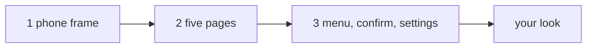

# The gallery's missing pages, recap, 2026-11-22

You asked for the gallery to show every kind of page the app's screens are, the phone's drawn at its width, so a coder builds a new page from a kind, not from a copy.

## What landings 1 and 2 give you

- The gallery has a kind "Kinds of page"; each entry draws its states from parts only and says what a new page of its kind must have.
- A phone plate draws a page 390 px wide in a frame whose breakpoints are the phone's; the mock's frame draws as before.
- Five pages: the phone page (six states), the list page (six, the last a card a row), the form page (four), the day sheet (three) and the import page (choose, the preview, done).
- `Panel` takes an address and is then one link over the block; Fields gains a file field.
- Landing 2: the menu page (two states, from `MenuRow`), the confirm page (a delete, a change, made, with `CopyText` in its field) and the settings page (basics, saved, refused); Fields gains a colour field. The gallery holds 44 entries.
- A row's result in the import preview is drawn by its meaning (success, danger), never a colour's name. No screen moved.

## What was proved

- Each step's gate on its own tree read green, `visual`'s pinned file unchanged, each new guard seen red once by a mutation.
- Landing 1's whole check on `pre-merge`, run 2026-11-22 from 23:39 to 23:49, exited 0 and read green.
- Landing 2's checks on `pre-merge`, run 2026-11-23, 00:51 to 00:56, exited 0, green: the `ui` and `visual` gates and the `scripts` citation, counts, words and fake tests.
- Item 667 (lists scroll sideways) stays open for the screens' move, now that cards are the rule. Item 668 (the call link under 36 px) stays open, deferred: its trigger, the next change to `MyDeliveryPage.tsx`, has not come.

## What is left

- Your one look, two points together (the phone's pages, the office's pages), asked 2026-11-23 at 00:51, answered yes at 06:34 ("thank you, and yes"): a card a row is the phone's rule for a list, and the eight kinds of page are the screens' targets (item 651).
