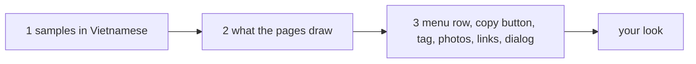

# The gallery's missing parts, recap, 2026-11-22

You asked for the gallery's samples in the staff's language first, then the parts the screens draw and the gallery lacks.

## What each landing gives you

- **1**: every sample opens in Vietnamese, a "Sample language" picker beside the colour theme turns them English, and the gallery's own words stay English for the coder. A sample a screen says shows the screen's own word; the Formats state shows a price, a number's marks, a day and a time as the picked language writes them.
- **2**: Mantine's own Fields (with the staff list's filter bar) and Choices, and two parts of ours, the table and the framed panel, each with its entry and contract.
- **3**: the menu row and the frame's menus; the copy button, moved to the molecules and taking a field; the small tag; photos and codes, links and the dialog, all Mantine's own. Foundations now counts 9, the gallery 36 entries and the parts 25. No screen moved.

## What was proved

- **1 and 2**: each landing's checks on `pre-merge` (22 November, 20:46 and 21:18) read green: `ui`'s and `visual`'s gates, the citation test and the two `scripts` tests (from the piece file).
- **3**: every step's gate on its own tree read green, `visual`'s pinned file unchanged, and each new guard was seen red once. _Not yet known:_ <!-- FILL: landing 3's checks on `pre-merge`, their result and time -->
- Three pairs name each other, so a coder finds the winner: `Panel` and `SectionCard`, `DataTable` and `ListTable`, `Tag` and `StatusBadge`.
- Item 507 closes; item 651 gained the five parts' site counts and item 515 stays parked, the reason written in it.

## What is left

- Your one look, three points together: the samples in Vietnamese, the five new parts, Mantine's own as the theme dresses them. A yes keeps them; a no names the entry and reopens its step. <!-- FILL: your answer to the look, not yet asked -->
- The screens' move onto these parts is item 651's, a milestone behind the pages; items 555, 306, 307 and 505 stay as the plan says.
