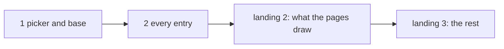

# The gallery's missing parts, recap, 2026-11-22

You asked for the gallery's samples in the staff's language first, then the parts the screens draw and the gallery lacks.

## What each landing gives you

- **1**: every sample in the gallery opens in Vietnamese, a "Sample language" picker beside the colour theme turns them English, and the gallery's own words (names, descriptions, use lines) stay English for the coder. A sample a screen says shows the screen's own word; the Formats state shows a price, a number's marks, a day and a time as the picked language writes them.
- **2**: the gallery gains the parts the pages draw: Mantine's own Fields (text, password, number, long text and drop-down, each with a hint, an error and read-only, and the staff list's filter bar) and Choices (tick boxes, switches, a one-of-many list and the segmented pick, as the settings page and the permission editor draw them), and two parts of ours, the table and the framed panel, each with its entry and contract.
- **3**: not built yet.

## What was proved

- **1**: its two steps are built; the evidence is below once the landing's check on `pre-merge` has read. _Not yet known:_ that check's result.

## What is left

- Your look at the samples in Vietnamese: not asked yet, it comes with the last step. _Not yet known:_ your answer.
- Landings 2 and 3, and the items they close (507) or leave (651, 515, 555, 306, 307, 505): see the plan.
