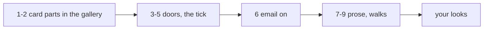

# The sign-in card, recap, 2026-11-23

You asked for the password ways on the legacy's card: a code or an email in one box, a "Remember me" tick, email sign-in on by default, and every door in the legacy's look.

## What the piece gives you

- A door page, a gallery part with three states: the brand's colour sweep, the language switch in its corner, the card centred.
- The company's sign-in, its QR landing, the operators' sign-in and the join page all stand on it (eight doors in the walks' question).
- "Remember me" is ticked by default; unticked, the sign-in lasts the browser tab only (the tab's storage beside the device's).
- Email sign-in is on by default; a saved choice is kept, no stored data touched.
- The walks gain one scene, a staff member signing in by the email the root gave.

## What was proved

- Each of steps 1 to 8 read its gates green on its tree.
- The walks: bases committed in two commits (48 pictures, then the staff walk's 78, 6 of them new). The recheck moved nothing on three walks; passkeys stalled once, green on a rerun alone: item 672 (Low, deferred).
- Item 671 (gallery tests time out under load) stays open.
- The 5 November header decision is reversed, written in the decisions page.

## What is left

- Your gallery look (asked 23 November 16:10): open, it stops nothing.
- Your look on ridge, after the push.
- Landing on `pre-merge`: <!-- FILL: the landing -->
- The whole check: <!-- FILL: its verdict -->
- `pre-main-review`: <!-- FILL: its findings -->
- The push and ridge's deploy: <!-- FILL: when and what ran -->
