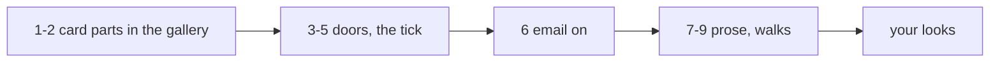

# The sign-in card, recap, 2026-11-23

You asked for the password ways on the legacy's card: a code or an email in one box, a "Remember me" tick, email sign-in on by default, and every door in the legacy's look.

## What the piece gives you

- A door page, a gallery part with three states: the brand's colour sweep, the language switch in its corner, the card centred.
- The company's sign-in, its QR landing, the operators' sign-in and the join page all stand on it.
- "Remember me" is ticked by default; unticked, the sign-in lasts the browser tab only, except that a browser set to reopen its last tabs brings it back, as on any site; the machine decided that on 11-23, and a no from you adds a server-side end.
- Email sign-in is on by default; a saved choice is kept, no stored data touched.
- The walks gain one scene, a staff member signing in by the email the root gave.

## What was proved

- The walks: bases committed in two commits; the recheck moved nothing on three walks; passkeys stalled once, green on a rerun: item 672.
- The 5 November header decision is reversed, in the decisions page.

## How it closed

- Your looks (the gallery, the sign-in on ridge, restored tabs): all yes on 23 November, before ridge had the new build; the yes stands.
- `pre-merge`: four landings on the evening of 23 November, then the morning of 24 November for step 11; `main` followed after its checks cleared.
- The whole check: red once on the first landing (a gallery case timing out, item 671, fixed in step 10c with a 10 s timeout), green after that fix, green again before the push.
- `pre-main-review`: five wrong facts in docs and comments, no code defect, fixed in step 10d; its reread found one memo clause, fixed in step 10e.
- The push: its app checks went red on one timing test in the walk script's tests, untouched by the push (item 676) (the docs site and the walks page green). Fixed forward in step 11, pushed again on the morning of 24 November: app checks green, ridge deployed.
