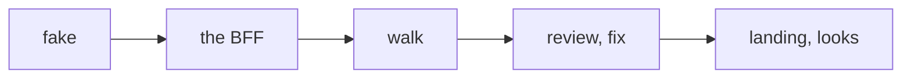

# Signing in by passkey, recap, 2026-11-24

You asked for every company's people, the root too, to sign in by a passkey they add, beside the password.

## What the piece gives you

- Under "or" the door draws "Sign in with a passkey"; a failure is told, the form kept.
- "Add a passkey" follows "Change password" in the user menu; the page says the password stays.
- The add needs a sign-in from the last ten minutes, the machine's decision (point 4); a no from you makes it ask the password.
- Passkeys are on until the root unticks the third switch under "Sign-in methods".
- Five scenes join the staff walk.

## What was proved

- Each business row was seen red on the old code, then green.
- Your walk run this morning was green; its bases are in.
- One review found four blocks (a 404 drawn as a failure, a bare button, false prose, wrong comments); one fix pass mended them, its reread green.
- Deferred: item 677 (the menu ignores the switch), 679 (a passkey outlives a password change until milestone 4), 680 (a button that fails at the operators' address, beside item 291).

## How it closed

- Point 1, the gallery: yes.
- The recheck walk run: your second walk run of 24 November, after the review's fixes, was green; its two scenes' twelve pictures moved and are in the bases, the other walks 0 moved.
- Point 2, the walks page: yes, to all twelve screens asked.
- `pre-merge`: the branch landed on it and the whole check passed on it; `main` was moved to it.
- The push: you pushed `main` on 24 November; GitHub's three runs (the app's checks, the docs site, the walks page) passed, and the app's check put the back end and the app on ridge.
- Point 3, on ridge: yes: an iPhone in Safari and a PC in Chrome each added a passkey, signed out, signed in with it, then signed in as the root; each press worked the first time and read like the legacy's.
