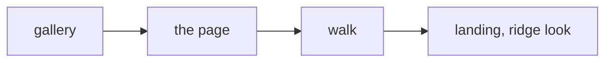

# The settings page in four blocks, recap, 2026-11-24

You asked for the branding campaign's first milestone: the settings fields in clear sections, beside a preview of what the company's people will see.

## What the piece gives you

- The settings page draws today's fields in four titled blocks, Identity, Pictures, Color and frame and Languages, with one save after them. No field is new and the back end did not change.
- Beside the blocks (above them on a phone) a preview draws the header and the sign-in card in the name, logo, colour and white header as typed, before any save. The app around keeps the saved look until the save.
- The preview is hidden from a screen reader and takes no focus; its header is the app's own, drawn by both.
- The admin's setup walk gains a thirteenth scene, the preview with a name typed and Brick picked, not saved.

## What was proved

- Each new row was seen red on the old code, then green; the settings form's old 21 cases stand with no line removed.
- The header and every door draw as before: the pinned diff was empty in step 1 and named only the settings screens after step 2.
- Your walk run of 24 November, late afternoon, was green: the admin walk's 42 pictures moved and 6 are new, the office's settings picture moved, and the same walks again moved none.

## How it closed

- The mock's look: yes. Point 1, the gallery: yes.
- The landing on `pre-merge`, the whole check and the review before `main`: <!-- FILL: each one's verdict in words, once they have run -->
- The push and the deploy to ridge: <!-- FILL: done or not -->
- Point 3, on ridge, a PC and a phone: <!-- FILL: your look's answer, yes or no -->
