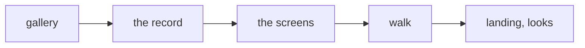

# The company's name everywhere, recap, 2026-11-25

You asked for the branding campaign's second milestone: each company's own name where its people look.

## What the piece gives you

- The settings page's Identity block gains two fields: a name with formatting, typed as HTML (a bold part, a second colour, a line break), with a live preview; and a short description.
- The header and the sign-in card, the QR landing's too, draw the formatted name, and the card the description under it. On the coloured header the colours give way to the header's text colour.
- The browser's tab says the company's plain name, "Credo" until the settings are known and on the failure screens. The page is marked in the language shown.
- The admin's setup walk grows from thirteen scenes to sixteen: the fields typed, saved, and the signed-out card.

## What was proved

- Each new row that could fail was seen red on the old code, then green; the rows that already held stayed green. The tab's title and the page's language are held by jsdom tests only; the walk's own browser check is item 693, filed. The pinned diff named only the settings screens after the screens, and only the three new ones after the walk.
- Your walk run of 25 November (14:40 to 14:55) was green: the admin walk moved none between its two passes, 48 pictures moved against the old bases and 18 are new; the office's settings picture moved.
- Item 681 is fixed; item 683 is filed: a company's new passkey is still made for "Credo", until milestone 4.

## How it closed

- Point 1, the gallery: yes, the afternoon of 25 November.
- The landing on `pre-merge`, the whole check and the review before `main`: the whole check was green; the review was red on three Medium and two Low blocks (a missing field bound, the tab and language held by jsdom only, words in documents), one fix pass answered them, and `main` took the branch.
- Point 2, the walks page: yes, the evening of 25 November.
- The push and the deploy to ridge: you pushed `main`, and then read the page on ridge.
- Point 3, on ridge: yes, 25 November.
