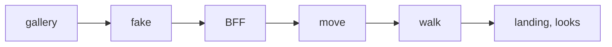

# The logo in the header, recap, 2026-11-26

You asked for the branding campaign's third milestone: the company's own logo in the header, where a stand-in icon had sat since 3 November.

## What the piece gives you

- The header draws the company's logo in its 36-pixel square; on the coloured header a second, light logo goes bare, and the one logo alone sits on a white tile. With none set, the stand-in stays.
- Settings gain a second logo, in a Pictures block. Each picture saves at once when chosen, never with the rest of the settings, and the preview wears both.
- Each picture is a record of its own, served at an address that names the company, so milestone 4's icons reuse the route.
- A logo already stored inside the settings moves to a picture the first time the settings are read; no script for you on ridge.
- Items 76 and 103 are fixed.

## What was proved

- Each row that could fail was seen red on old code or by a mutation, then green; rows that already held stayed green. The gates of `shared`, `bff`, `scripts`, `ui`, `visual` and `walk` read green at each step, as the plan's ticks say.
- The admin's setup walk gains one scene, `21-logo-on-colour`, after the take-in renumbered it.
- The human's walk run of 2026-11-26, 14:13, was green: 618 pictures moved against the old bases, 6 new, none a door or the console, and 0 moved between its two passes. The bases are committed alone.

## Where it stands

- Point 1, the gallery: yes, 25 November.
- Point 2, the walks page, and point 3, on ridge: open.
- <!-- FILL: the landing on `pre-merge` and its result -->
- <!-- FILL: the whole check and its result -->
- <!-- FILL: the review before `main` and its findings -->
- <!-- FILL: the push and the deploy to ridge -->
