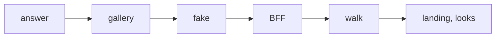

# A company's own sign-up, recap, 2026-11-26

You asked for the sign-in campaign's fifth milestone: a company signs itself up, root and all, and starts once a credo operator approves it. It lands with milestones 3 and 4.

## What the piece gives you

- Your answer, operator approval, is a row in `docs/decisions.md`: the app sends no mail.
- `/sign-up`, reached from the unknown-company page, takes the company's name and address, the requester's name and phone, and the root's password, kept as its hash alone. The address then says it is waiting, and its root cannot sign in.
- At most 20 requests wait; an address held, taken or waiting is a 409.
- Clients gains "Waiting for approval". Approve makes the company with the chosen password; Refuse frees the address, each after a question, for a signed-in operator only.
- Not in it: mail, an expiry, a link on a company's card.

## What was proved

- Each business row was seen red on the old code, then green. The doors' walk gains four scenes and the operator's three. The count before the write is not atomic, so a burst can pass 20; the stage's throttle bounds it.
- Your four walk runs of 26 November ended green, the last at 07:50 with 0 moved between its two passes; the first three each stopped on a walk slip, the starred labels and the sent address's port this piece's, fixed in `8a25fe7f` and `715d1e34`. Bases: `487e5cfc`, `d658045b`.

## How it closed

- Your answer: yes, 25 November. Point 1, the gallery: yes.
- The landing on `pre-merge`, the whole check and the review: <!-- FILL: the landing, the whole check's verdict and the review's findings, once they have run -->
- Point 2, the walks page, and ridge after the push: <!-- FILL: your answers, once the page and ridge are open -->
