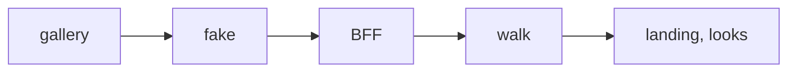

# Passkeys kept, recap, 2026-11-26

You asked for the sign-in campaign's fourth milestone: a person sees and removes their own passkeys, and the root removes a person's for a lost phone. It lands with milestones 3 and 5.

## What the piece gives you

- The user menu gains "Passkeys": each one's device, the day it was added and last used. A removal asks first, and a sign-in by it is refused at once.
- On a person's page the root reads "Passkeys held" and removes them all after a question. Only the root may.
- A removal ends the person's other sessions and keeps the removing device in, the machine's decision.
- Where passkeys are off, the list, both removals and the count answer 404; another company's person is a 404 too.
- Not in it: a password change that drops passkeys; item 679 stays open for it.

## What was proved

- Each business row was seen red on the old code, then green, in the BFF's route tests and the UI's. The walk gains seven scenes, Lan's two passkeys written at fixed days.
- Your four walk runs of 26 November ended green, the last at 07:50 with 0 moved between its two passes; the first three each stopped on a walk slip, one the passkeys table's scroll offset, fixed in `5961e41b`, `8a25fe7f` and `715d1e34`. The office walk's bases are `572f7b6a`; More's, `487e5cfc`.

## How it closed

- Point 1, the gallery: yes, 25 November.
- The landing on `pre-merge`, the whole check and the review: The three milestones landed together on `pre-merge` on 26 November. The whole check went red twice that morning (a package never installed there, then the dev scripts' tests stalling on a loaded machine), green on its third run and again after the fix pass. The review found eight blocks, four in the screens, four in the docs, all fixed in one pass; `main` moved to that landing.
- Point 2, the walks page, and ridge after the push: Your answers, 26 November: the ridge look "Tested and all ok", the walks page's 44 screens "YES for all". You pushed `main` to ridge the same day.
