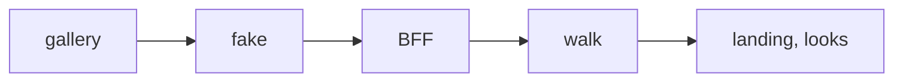

# QR from the sign-in screen, recap, 2026-11-26

You asked for the sign-in campaign's third milestone: signing in by scanning a code from the sign-in screen, as the legacy did. It lands with milestones 4 and 5.

## What the piece gives you

- The card gains "Use a QR code", on for every company by default. Its scan page reads the camera, a picture of the code, or a pasted link.
- A good code signs in with a green tick; a used, late or wrong one is refused in the landing's words, with the way back to the password.
- The root's QR panel gains a copy button and a question before a new code replaces one shown.
- The door asks `GET /api/auth/methods`, which needs no session.
- The reader is `jsQR` 1.4.0, your yes to point 1, since Safari has no built-in one.

## What was proved

- Each business row was seen red on the old code, then green. The phone's walk gains four scenes: the choice, a pasted code signed in, a used code refused, no camera. A picture read cannot be replayed there, so `QrScanPage.test.tsx` holds it.
- Your four walk runs of 26 November ended green, the last at 07:50 with 0 moved between its two passes; the first three each stopped on a walk slip, fixed in `5961e41b`, `8a25fe7f` and `715d1e34`. The phone walk's bases are `572f7b6a`.

## How it closed

- Point 1, `jsQR`: yes. Point 2, the gallery: yes, 25 November.
- The landing on `pre-merge`, the whole check and the review: The three milestones landed together on `pre-merge` on 26 November. The whole check went red twice that morning (a package never installed there, then the dev scripts' tests stalling on a loaded machine), green on its third run and again after the fix pass. The review found eight blocks, four in the screens, four in the docs, all fixed in one pass; `main` moved to that landing.
- Point 3, the walks page, and ridge after the push: Your answers, 26 November: the ridge look "Tested and all ok", the walks page's 44 screens "YES for all". You pushed `main` to ridge the same day.
