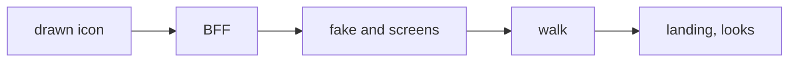

# The tab icon and the phone app, recap, 2026-11-26

You asked for the branding campaign's last milestone: each company's own icon in the browser's tab and on a phone's home screen, under its name.

## What the piece gives you

- Settings gain a tab icon and a phone-app icon in the Pictures block. Each is made in the browser at its choice, saved at once, and the preview's tab and home-screen tile wear it.
- A company with none gets an icon drawn from its colour and first letter; removing one brings it back.
- On a phone, "Add to Home Screen" names the company, shows its icon and opens full screen at its sign-in, the bar in the header's colour. The BFF writes that description from the settings, at an address naming the company.
- A company's new passkey is made for its plain name (item 683, fixed).

## What was proved

- Each row that could fail was seen red on old code, then green; each step's gates read green, as the plan's ticks say.
- The admin's setup walk gains one scene, `22-icons`, with both icons uploaded.
- The human's walk run of 2026-11-26, 15:53 to 16:13, was green: piece 1 had 66 moved and 6 new, piece 2 had 6 moved, and 0 moved between each walk's two passes. The bases are committed alone, none a door or the console.

## Where it stands

- Point 1, the gallery: yes, 25 November.
- Points 2 and 3, the walks page and ridge: yes, 26 November.
- Landed on `pre-merge` as `88292e3e`; the review's fixes as `24e9f44c`, the test fix as `eadeb2a2`.
- The whole check of `88292e3e`, 16:18 to 16:28, ended green: exit 0; so did that of `24e9f44c`, 17:00 to 17:09.
- The review before `main` read red, five blocks: one in code (a photo's icon refused with words that blamed the name), four in words. `ad2bc262` and `d353d6e2` closed them; items 700 and 701 are fixed, 702 and 703 deferred.
- Pushed twice. The first run of `24e9f44c` was red on one `shared` test that timed out on GitHub's runner, so no deploy; `caa5da6d` compares pixels by bytes. `main` at `eadeb2a2` ran green and deployed, by your word.
