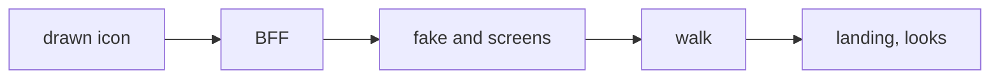

# The tab icon and the phone app, recap, 2026-11-26

You asked for the branding campaign's last milestone: each company's own icon in the browser's tab and on a phone's home screen, under its name.

## What the piece gives you

- Settings gain a tab icon and a phone-app icon in the Pictures block. Each is made in the browser at its choice, saved at once, and the preview's tab and home-screen tile wear it.
- A company with none gets an icon drawn from its colour and first letter; removing one brings it back.
- On a phone, "Add to Home Screen" names the company, shows its icon and opens full screen at its sign-in, the bar in the header's colour. The BFF writes that description from the settings, at an address naming the company.
- A company's new passkey is made for its plain name (item 683, fixed).

## What was proved

- Each row that could fail was seen red on old code, then green; the gates of `shared`, `bff`, `scripts`, `ui`, `visual` and `walk` read green at each step, as the plan's ticks say.
- The admin's setup walk gains one scene, `22-icons`, with both icons uploaded.
- The human's walk run of 2026-11-26, 15:53 to 16:13, was green: piece 1 had 66 moved and 6 new, piece 2 had 6 moved, and 0 moved between each walk's two passes. The bases are committed alone, none a door or the console.

## Where it stands

- Point 1, the gallery: yes, 25 November.
- Point 2, the walks page, and point 3, on ridge: open.
- <!-- FILL: the landing on `pre-merge` and its result -->
- <!-- FILL: the whole check and its result -->
- <!-- FILL: the review before `main` and its findings -->
- <!-- FILL: the push and the deploy to ridge -->
